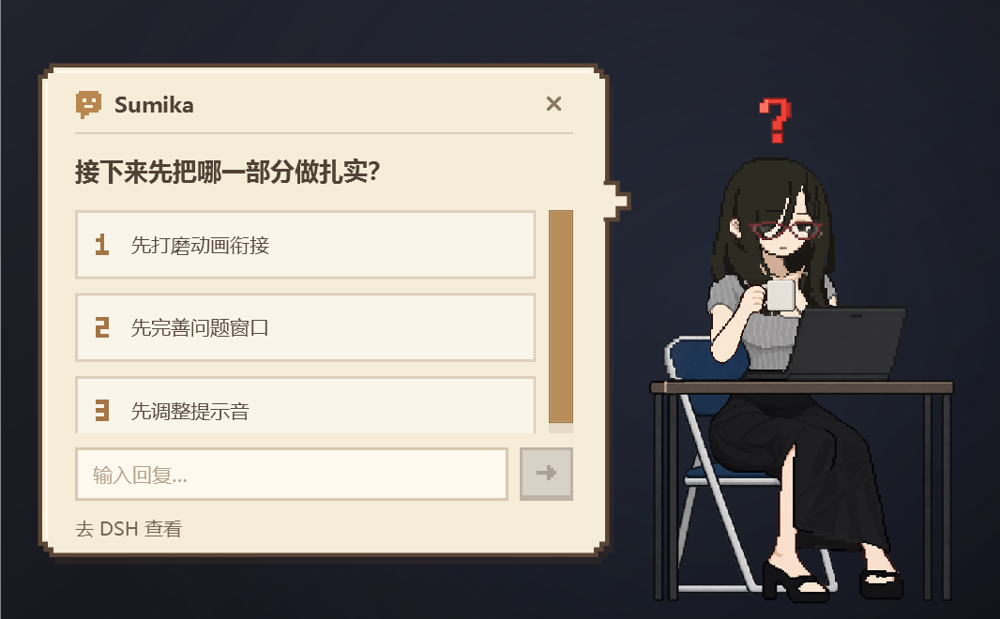
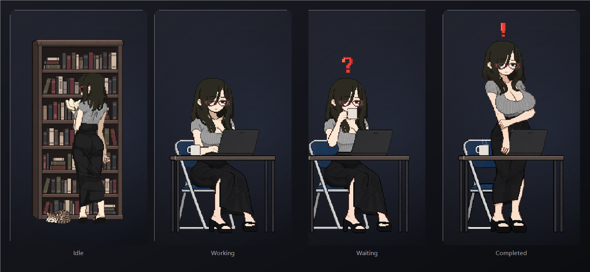
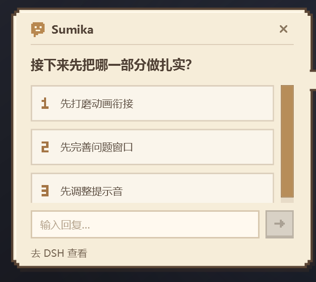

# Sumika — a desktop character for DeepSeek Harness



`Sumika` is a desktop widget for the Windows version of DeepSeek Harness. It stays on top of the
desktop and switches its animation with the agent's state. Its main highlight is that the real
questions and approvals from the harness are shown on a small pixel-art card, where you can answer
directly, or jump back to DeepSeek Harness with one button — a virtual pet for the harness, similar
to Codex's.

“Sumika”是一款面向 Windows 版本的 DeepSeek Harness 开发的桌面挂件。该挂件常驻在桌面的最上层，会根据智能体的不同工作状态切换对应动画。它最大的亮点是将源自 DeepSeek Harness 的提问和审批显示在一枚像素风小卡片上，在该卡片上你可以直接作出回答，也可以通过一个跳转按钮快速切回 DeepSeek Harness，类似 Codex 的虚拟宠物。

## What it does / 功能

- **Agent state on the desktop** — idle / working / waiting / finished, driven by the harness's own
  `agent/status` and `turn/end` events, not by polling the UI. / 桌面显示智能体的实时状态。
- **Real questions, answered from the desktop** — the plugin wraps the harness's
  `user-questions/request` and `approval/request` waterfalls, so the same question the harness would
  ask in the window also shows up on the desktop card. Answering on either side settles both.
  / 真实的提问与审批会同步到桌面卡片，两边任一处回答即生效。
- **Sounds** — a waiting sound and a completion sound, both replaceable with your own WAV/MP3/WMA/M4A
  file from the settings panel. / 可自定义等待与完成提示音。
- **Settings page** — size, screen margin and volume, each adjustable by slider or by typing an exact
  integer number. / 设置页可拖动滑块，也可直接键入整数。
- **Bringing the harness back** — double-click the character to bring the DeepSeek Harness window to
  the front. / 双击角色可以把 DeepSeek Harness 窗口调到最前。

## States / 状态



The character never sits still: it browses the shelf while idle, types at the desk while the agent is
running, holds a cup and raises a “?” while a question is waiting, and stands up with a “!” when the
turn is finished. The four animations swap on their own entrance and exit clips, so a state change
looks like one continuous piece of acting rather than a jump cut. / 角色会跟随智能体切换状态：闲置时在书架前翻书，工作时坐到桌前打字，有提问时端着杯子举出问号，本轮结束时起身并弹出感叹号。四段动画各自带有出场与消散过渡，衔接起来像一段连贯的表演，而不是硬切。

## The question card / 提问卡片



The card reuses the harness's own question payload: options keep their numbering, a long label scrolls
inside its row once selected, the text field accepts a free-form answer, and “去 DSH 查看” brings the
harness window to the front with the same question still open. / 卡片直接复用智能体传来的提问内容：选项保留原有编号，长文本在选中后会在选项内滚动，输入框可以填写自由回答，点击“去 DSH 查看”会把 DeepSeek Harness 窗口调到前台，并保留同一道提问。

## Character / 角色来源

注意！本项目的 Sumika 角色源自于《CIRCLEMATE サークルメイト》（CIRCLEMATE: Her Secret）中的澄华（Sumika）。原作由 STEEL NYANKO（スチールニャンコ）制作，衷心感谢原作者的创作。

- [游戏官方页面](https://store.steampowered.com/app/6544610/)
- [制作方主页](https://ci-en.dlsite.com/creator/33935)

The Sumika character and all of the artwork in this project come from CIRCLEMATE
(CIRCLEMATE: Her Secret) by STEEL NYANKO. All credit for the character and the art belongs to the
original creator; this project only uses the sprites as a desktop widget skin.

## Requirements / 环境要求

| | |
|---|---|
| OS | Windows 10 1903+ / Windows 11, x64 only |
| Runtime | .NET Framework 4.8 (included in Windows 10 1903+ and Windows 11) |
| Harness | DeepSeek Harness 0.2.1-rc.3 (tested) |

Everything else is bundled: the C++ runtime (`runtime/vcruntime140.dll`) and the WebP decoding
libraries live next to the executable, so installation does not download anything.

## Install / 安装

From DeepSeek Harness: **Settings → Plugins** and install this directory, or from the command line:

```sh
dsh plugin add https://github.com/pucco-OD/dsh-sumika-widget
```

Then restart the harness and open **Settings → Sumika**.

To uninstall, remove the plugin from **Settings → Plugins**; the widget window closes with it. The
settings and logs in `%LOCALAPPDATA%\Sumika` are left behind and can be deleted by hand.

The plugin writes its settings, logs and decoded-asset cache to `%LOCALAPPDATA%\Sumika`.
Nothing is sent anywhere: the widget talks to the harness over a loopback HTTP endpoint with a
random per-run bearer token.

## Build from source / 从源码构建

The native window is C# / WPF, compiled with the compiler that ships with .NET Framework:

```powershell
./build.ps1 -Release
```

This produces `CodexPet.exe` and copies it to `runtime/Sumika.exe` (the file the plugin launches).
`-Release` defines `SUMIKA_RELEASE`, which strips the development-only test hooks. Tests live in
`tests/` and are compiled by the same script.

## Layout / 目录

| Path | |
|---|---|
| `index.js` | host plugin: controller, lifecycle, HTTP surface |
| `agent-state.js` | follows `agent/status` / `turn/end` to know what to show |
| `questions.js` | wraps the question and approval waterfalls |
| `client.js` | settings page (web client half) |
| `src/`, `ui/` | the WPF desktop window and its XAML |
| `runtime/` | the compiled widget, its DLLs and the artwork |
| `docs/` | the preview images used by this README |

## Credits / 第三方

- [libwebp](https://chromium.googlesource.com/webm/libwebp) (BSD-3-Clause) — animated WebP decoding,
  shipped as `runtime/native/libwebp*.dll`; see `licenses/`.
- Microsoft Visual C++ 2015-2022 runtime (`vcruntime140.dll`), redistributed app-local under
  Microsoft's redistributable terms.

## License

MIT — see [LICENSE](LICENSE).
